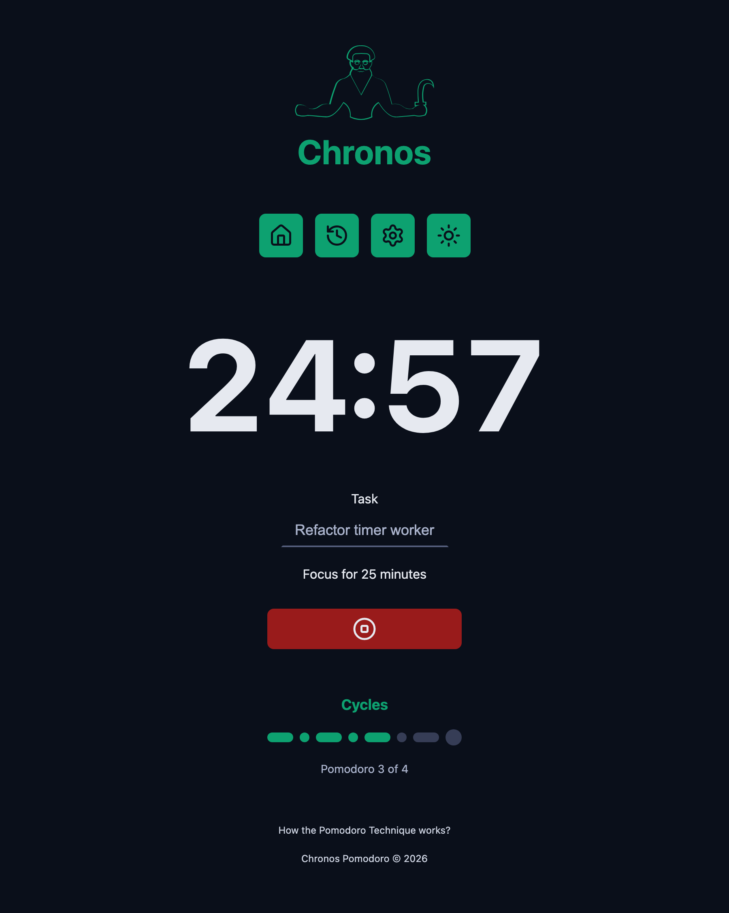
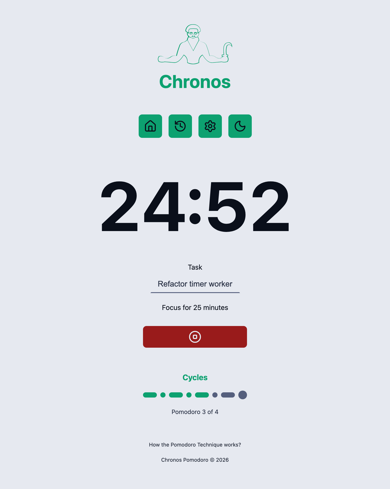
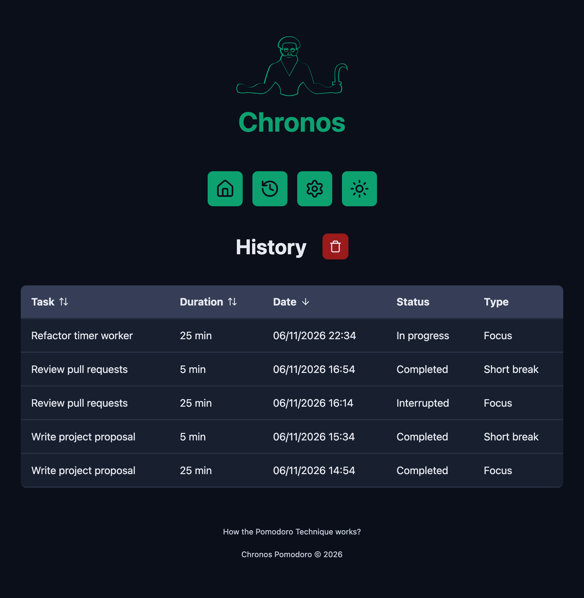
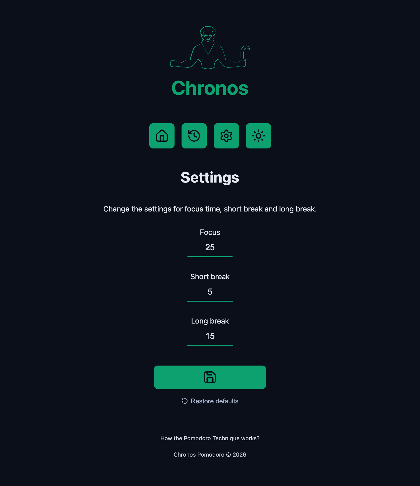
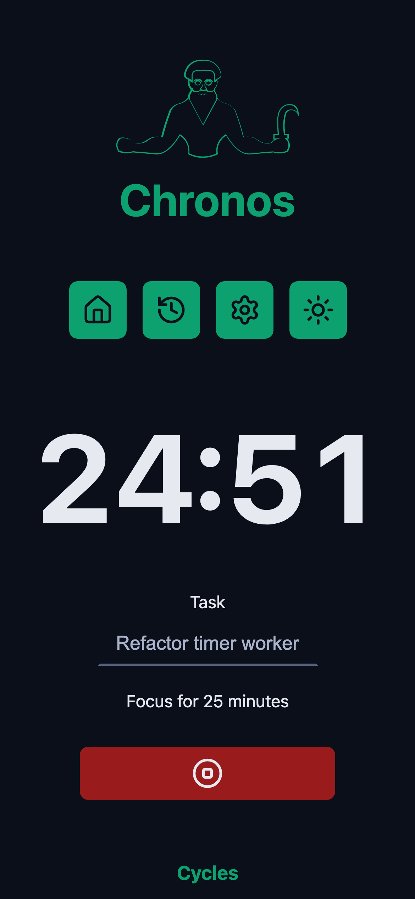

# Chronos Pomodoro

A focus timer based on the Pomodoro Technique. Name a task, start the clock, and Chronos walks you through focus sessions and breaks, keeps a history of everything you did, and lets you tune each interval.

Built with React 19, TypeScript and Vite.

**[Live demo →](https://chronospomodoro.vercel.app)**

<p align="center">
  
  
</p>

## Features

- **Pomodoro cycles**: 8-step sequence of focus, short breaks and a long break, picked automatically for each new task.
- **Cycle track**: shows completed, current and upcoming steps at a glance, with a "Pomodoro 3 of 4" progress label and a restart action.
- **Accurate countdown**: the timer runs in a Web Worker and is computed from the task's start time, so it stays correct even when the tab is in the background.
- **Live tab title**: the browser tab shows the remaining time while a task runs, and the page name otherwise.
- **Task history**: sortable table with the duration, date, status (completed, interrupted, in progress) and type of every task.
- **Custom intervals**: set focus, short break and long break lengths, with validation and a one-click restore to the defaults.
- **Persistence**: tasks, cycles and settings survive page reloads through `localStorage`.
- **Light and dark themes**, a sound when a cycle ends, toasts and confirmation dialogs.
- **Responsive and keyboard friendly**: works on small screens and has visible focus styles.

## Screenshots

| History | Settings | Mobile |
| --- | --- | --- |
|  |  |  |

## Tech stack

| Area | Tools |
| --- | --- |
| UI | React 19, TypeScript (strict), SCSS Modules |
| Build | Vite 7 with SWC, `vite-plugin-svgr` |
| Routing | React Router 8 |
| State | `useReducer` + Context, persisted to `localStorage` |
| Timer | Web Worker |
| Libraries | `react-toastify`, `lucide-react`, `date-fns` |
| Quality | ESLint 9 (typescript-eslint, react-hooks, react-refresh) |

## How it works

All timer state lives in a single reducer exposed through `TaskContext`. Starting a task dispatches `START_TASK`, which picks the next cycle (`getNextCycle` and `getNextCycleType`) and stores the task with its start time.

The countdown does not decrement a counter. A Web Worker computes the remaining time from `startDate` on every tick and schedules the next tick on the exact second boundary. This keeps the display precise and avoids drift when the browser throttles timers in background tabs. When the worker reports zero, the app dispatches `COMPLETE_TASK` and plays the bell.

```
src/
├── adapters/      toast wrapper (showMessage)
├── components/    UI building blocks (CountDown, Cycles, MainForm, Dialog, ...)
├── contexts/      TaskContext: actions, reducer, provider, initial state
├── pages/         Home, History, Settings, AboutPomodoro, NotFound
├── routers/       route definitions
├── utils/         cycle logic, sorting, formatting
└── workers/       timer Web Worker and its manager
```

## Running locally

Requires Node.js 20.19+ or 22.12+ (Vite 7). The project is developed on Node 23.

```bash
git clone git@github.com:aversvs/chronos-pomodoro.git
cd chronos-pomodoro
npm install
npm run dev
```

| Script | What it does |
| --- | --- |
| `npm run dev` | Starts the Vite dev server |
| `npm run build` | Type-checks and builds to `dist/` |
| `npm run preview` | Serves the production build |
| `npm run lint` | Runs ESLint |

## Deployment

The app is deployed on [Vercel](https://chronospomodoro.vercel.app) and redeploys on every push to `main`. It is a static single-page app: `vercel.json` rewrites every route to `index.html`, so links such as `/history` and `/settings` also work on a full page reload.

## Credits

- Chronos illustration by Icons Producer from [the Noun Project](https://thenounproject.com).

## License

[MIT](LICENSE) © Thiago Fuganti
